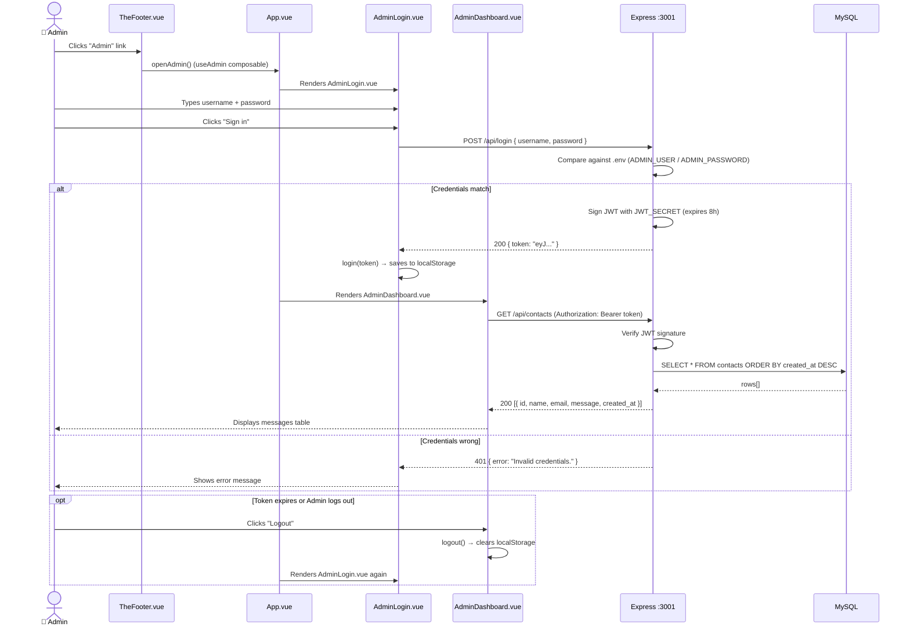

# 📁 Project File Guide — Personal Portfolio Platform

> Every file in this project, explained in plain English.

---

## 🗺️ Project Structure

```
project-root/
├── index.html                  # Entry HTML page
├── package.json                # Frontend dependencies & scripts
├── vite.config.ts              # Vite dev server & build config
├── tsconfig.json               # TypeScript config (app)
├── tsconfig.node.json          # TypeScript config (build tools)
├── docker-compose.yml          # MySQL container
├── .gitignore                  # Files excluded from Git
├── README.md                   # Project readme
├── env.d.ts                    # Vite client type shims
├── public/
│   └── favicon.svg             # Browser tab icon
├── server/                     # Backend (Express + MySQL)
│   ├── package.json
│   ├── tsconfig.json
│   ├── .env                    # Secrets (not committed)
│   └── src/
│       ├── index.ts            # Express entry point
│       ├── db.ts               # MySQL connection pool
│       ├── middleware/
│       │   └── auth.ts         # JWT verification middleware
│       ├── routes/
│       │   ├── contact.ts      # POST /api/contact (public)
│       │   ├── auth.ts         # POST /api/login (public)
│       │   └── contacts.ts     # GET /api/contacts (protected)
│       └── db/
│           └── schema.sql      # MySQL table definitions
└── src/                        # Frontend (Vue 3 + TypeScript)
    ├── main.ts                 # App bootstrap
    ├── App.vue                 # Root component
    ├── vite-env.d.ts           # Vite type declarations
    ├── assets/
    │   └── styles/
    │       ├── variables.css   # Design tokens (colors, spacing, fonts)
    │       └── main.css        # Global styles & resets
    ├── data/
    │   └── portfolio.ts        # All site content (single source of truth)
    ├── composables/
    │   ├── useTheme.ts         # Dark/light theme logic
    │   └── useAdmin.ts         # Admin auth state (shared)
    └── components/
        ├── AppIcon.vue         # Inline SVG icon component
        ├── TheHeader.vue       # Top navigation bar
        ├── TheFooter.vue       # Footer with admin link
        ├── HeroSection.vue     # Hero/intro section
        ├── AboutSection.vue    # About/bio section
        ├── SkillsSection.vue   # Skills with progress bars
        ├── ProjectsSection.vue # Project cards
        ├── ExperienceSection.vue # Work timeline
        ├── ContactSection.vue  # Contact form → MySQL
        ├── AdminLogin.vue      # Admin login form
        └── AdminDashboard.vue  # View contact messages
```

---

## 🚀 Setup Guide — From Zero to Running

### Prerequisites

| Tool | Why needed | Install from |
|---|---|---|
| **Node.js** v18+ | Runs the frontend & backend | [nodejs.org](https://nodejs.org) |
| **Docker Desktop** | Runs MySQL in a container | [docker.com](https://docker.com/products/docker-desktop/) |
| **Git** (optional) | Clone the project | [git-scm.com](https://git-scm.com) |

### Step 1 — Install frontend dependencies

```bash
npm install
```

### Step 2 — Install backend dependencies

```bash
cd server
npm install
cd ..
```

### Step 3 — Start MySQL

```bash
docker-compose up -d
```

> This creates a MySQL 8.0 container named `portfolio-mysql`. The database `portfolio` and the `contacts` table are created automatically on first run.

Verify it's running:
```bash
docker ps
```
You should see `portfolio-mysql` in the list.

### Step 4 — Start the backend

Open a **new terminal**:
```bash
cd server
npm run dev
```

You should see: `[server] listening on http://localhost:3001`

### Step 5 — Start the frontend

Open **another terminal**:
```bash
npm run dev
```

Vite opens `http://localhost:5173` in your browser. 🎉

### Step 6 — Test the contact form

1. Open `http://localhost:5173`
2. Scroll to **Contact** at the bottom
3. Fill in your name, email (optional), and a message
4. Click **Send message**
5. You should see a green "Thank you!" message

### Step 7 — Test the admin panel

1. Scroll to the footer and click the faint **Admin** link
2. Login with: `qia` / `123123`
3. You should see your test message in the table

### Troubleshooting

| Problem | Fix |
|---|---|
| "Port 3306 already in use" | Stop any existing MySQL: `docker stop portfolio-mysql && docker rm portfolio-mysql` |
| "Port 5173 already in use" | Kill the process, or change port in [`vite.config.ts`](vite.config.ts) |
| "Cannot connect to MySQL" | Wait 10s after `docker-compose up -d` for MySQL to initialize |
| "401 Unauthorized" on admin login | Wrong credentials. Check [`server/.env`](server/.env) |
| "Network error" on contact form | Backend isn't running. Start `cd server && npm run dev` |

---

## 🌐 Root Files

### [`index.html`](index.html)
**The HTML skeleton.** Contains a `<div id="app"></div>` where Vue mounts the entire app, and a `<script>` tag that loads `src/main.ts`. Also sets the `<title>` tag (browser tab text) and meta description for SEO.

### [`package.json`](package.json)
**Frontend dependency list.** Defines:
- `vue` (the only runtime dependency — the UI framework)
- `vite` (dev server + bundler)
- `typescript`, `vue-tsc` (type checking)
- Scripts: `npm run dev` (start), `npm run build` (compile), `npm run preview` (preview build)

### [`vite.config.ts`](vite.config.ts)
**Vite configuration.** Sets up:
- Vue plugin (compiles `.vue` files)
- `@` alias → points to `src/` folder
- Dev server on port 5173, auto-opens browser
- Proxy: any request to `/api/*` is forwarded to `http://localhost:3001` (the Express backend)

### [`tsconfig.json`](tsconfig.json)
**TypeScript settings for the frontend app.** Configures strict mode, path aliases, and module resolution for Vue + Vite.

### [`docker-compose.yml`](docker-compose.yml)
**MySQL container definition.** Spins up MySQL 8.0 with:
- Database: `portfolio`
- User: `portfolio_user` / `portfolio_pass`
- Port 3306 exposed to localhost
- Automatically runs `server/src/db/schema.sql` on first startup to create tables

### [`.gitignore`](.gitignore)
**Files excluded from Git.** Prevents committing `node_modules`, `dist`, `.env`, and editor config files.

---

## 🖥️ Backend — `server/`

### [`server/package.json`](server/package.json)
**Backend dependencies:**
- `express` — HTTP server framework
- `mysql2` — MySQL client (with promises/async support)
- `cors` — allows frontend → backend requests
- `dotenv` — loads `.env` variables
- `jsonwebtoken` — creates/verifies JWT auth tokens
- `tsx` — runs TypeScript directly (no compile step needed)

### [`server/.env`](server/.env)
**Secret credentials** (never committed to Git):
| Variable | Purpose |
|---|---|
| `DB_HOST/PORT/USER/PASSWORD/NAME` | MySQL connection details |
| `SERVER_PORT` | Port for Express (3001) |
| `ADMIN_USER` / `ADMIN_PASSWORD` | Login credentials (`qia` / `123123`) |
| `JWT_SECRET` | Key used to sign auth tokens |

### [`server/src/index.ts`](server/src/index.ts)
**Express server entry point.** Sets up:
1. CORS (cross-origin requests)
2. JSON body parsing
3. Mounts 3 route groups under `/api`
4. Health check endpoint at `GET /api/health`
5. Starts listening on port 3001

### [`server/src/db.ts`](server/src/db.ts)
**MySQL connection pool.** Creates a pool of reusable database connections using `mysql2/promise`. Reads connection details from `.env`. All routes import this pool to run queries.

### [`server/src/middleware/auth.ts`](server/src/middleware/auth.ts)
**JWT authentication guard.** Express middleware that:
1. Reads the `Authorization: Bearer <token>` header
2. Verifies the token using `JWT_SECRET`
3. If valid → lets the request proceed
4. If invalid/missing → returns `401 Unauthorized`

Used by all protected routes.

### [`server/src/routes/contact.ts`](server/src/routes/contact.ts)
**`POST /api/contact`** (public — no auth needed).
Recieves `{ name, email, message }` from the contact form and inserts into the `contacts` MySQL table.

### [`server/src/routes/auth.ts`](server/src/routes/auth.ts)
**`POST /api/login`** (public).
Checks `{ username, password }` against `ADMIN_USER`/`ADMIN_PASSWORD` from `.env`. If correct, returns a JWT token (valid 8 hours). If wrong, returns `401`.

### [`server/src/routes/contacts.ts`](server/src/routes/contacts.ts)
**`GET /api/contacts`** (protected — requires JWT).
Returns all contact form messages from the `contacts` table, ordered newest-first.

### [`server/src/db/schema.sql`](server/src/db/schema.sql)
**MySQL table definitions.** Auto-executed when the Docker container starts for the first time:

```sql
CREATE TABLE contacts (
  id          INT AUTO_INCREMENT PRIMARY KEY,
  name        VARCHAR(255) NOT NULL,   -- submitter's name
  email       VARCHAR(255),            -- optional email
  message     TEXT NOT NULL,           -- the message body
  created_at  TIMESTAMP DEFAULT NOW()  -- auto-timestamp
);
```

---

## 🎨 Frontend — `src/`

### [`src/main.ts`](src/main.ts)
**App bootstrap.** The first code that runs:
1. Creates the Vue app from [`App.vue`](src/App.vue)
2. Imports global CSS
3. Mounts to `#app` in the HTML
4. Sets the browser tab title from `portfolio.ts`

### [`src/App.vue`](src/App.vue)
**Root component.** Acts as the page router without a router library:
- **Normal mode:** Shows `TheHeader` → all sections → `TheFooter`
- **Admin mode:** Shows `AdminLogin` or `AdminDashboard` + a "Back to Portfolio" button
- Switches between modes via `useAdmin().showAdmin` (triggered by footer "Admin" link)

### [`src/assets/styles/variables.css`](src/assets/styles/variables.css)
**Design tokens.** CSS custom properties defined once and used everywhere:
- **Colors:** primary, accent, background, surface, border, text, heading
- **Typography:** font families, sizes (`--fs-xs` through `--fs-4xl`), weights
- **Spacing:** 8-step scale (`--space-1` through `--space-9`)
- **Layout:** container max-width, border radii (`--radius-sm/md/lg/full`)
- **Effects:** shadows, transitions
- **Dark theme:** default palette (dark background, light text)
- **Light theme:** activated by `[data-theme="light"]` attribute on `<html>`

### [`src/assets/styles/main.css`](src/assets/styles/main.css)
**Global styles.** CSS reset, base typography, scroll behavior, button styles (`.btn--primary`, `.btn--ghost`), section layout, utility classes (`.text-gradient`, `.fade-in` animation).

### [`src/data/portfolio.ts`](src/data/portfolio.ts)
**Single source of truth for all site content.** This is the only file you edit to change your portfolio:
- **`profile`** — name, role, tagline, location, email, availability, summary
- **`navLinks`** — navigation menu items
- **`socials`** — GitHub, LinkedIn, email links
- **`skills`** — skill name + proficiency level (0-100)
- **`projects`** — project title, description, tags, links
- **`experience`** — work history entries

All components import from here. Change one value → entire site updates.

### [`src/composables/useTheme.ts`](src/composables/useTheme.ts)
**Dark/light theme toggle.** A Vue composable (reusable logic hook):
- `useTheme()` returns `{ theme, toggleTheme }`
- On mount, reads saved preference from `localStorage` (or OS setting)
- Applies theme by setting `data-theme="dark"` or `"light"` on `<html>`
- Toggle switches between dark ↔ light and saves to `localStorage`

### [`src/composables/useAdmin.ts`](src/composables/useAdmin.ts)
**Admin auth state.** Module-level singletons shared across all components:
- `token` — JWT stored in `localStorage`
- `showAdmin` — whether admin panel is visible
- `login(token)` — saves token after successful login
- `logout()` — clears token
- `openAdmin()` / `closeAdmin()` — toggle between portfolio and admin views
- `isLoggedIn` — computed: `true` when token exists
- `authHeaders()` — returns `{ Authorization: "Bearer ..." }` for fetch calls

---

## 🧩 Components

### [`src/components/AppIcon.vue`](src/components/AppIcon.vue)
**Inline SVG icon component.** Draws icons directly as SVG paths (no external icon library needed). Accepts:
- `name` — which icon to draw (`github`, `linkedin`, `mail`, `sun`, `moon`, `menu`, `close`, `arrow-down`, `code`, `map-pin`, `external`)
- `size` — width/height in pixels (default: 20)

### [`src/components/TheHeader.vue`](src/components/TheHeader.vue)
**Top navigation bar.** Features:
- Site name (from `profile.name`)
- Desktop nav links (from `navLinks`)
- Theme toggle button (sun/moon icon)
- Mobile hamburger menu (toggles on small screens)
- Sticky positioning (stays at top on scroll)

### [`src/components/TheFooter.vue`](src/components/TheFooter.vue)
**Page footer.** Shows:
- Profile name + tagline
- Quick nav links
- Social media icon links
- Copyright line
- **"Admin" button** (subtle, 45% opacity) → opens admin login

### [`src/components/HeroSection.vue`](src/components/HeroSection.vue)
**Hero/intro section.** The first thing visitors see:
- "Available" badge (green dot, shown when `profile.available`)
- Name + role with gradient text
- Tagline
- Two CTA buttons: "View my work" (→ projects) and "Get in touch" (→ contact)
- Social media links with animated fade-in

### [`src/components/AboutSection.vue`](src/components/AboutSection.vue)
**About/bio section.** Displays:
- Section heading: "About"
- Profile summary text from `profile.summary`
- Location with map pin icon

### [`src/components/SkillsSection.vue`](src/components/SkillsSection.vue)
**Skills showcase.** Dynamic skill bars:
- Lists all skills from `skills` array
- Each skill shows name + percentage bar (animated width to match `level`)
- Bars use the primary gradient color

### [`src/components/ProjectsSection.vue`](src/components/ProjectsSection.vue)
**Project cards.** Displays work in a grid:
- Project title, description
- Tag pills (technology badges)
- Link to live demo + GitHub repo (with external link icon)

### [`src/components/ExperienceSection.vue`](src/components/ExperienceSection.vue)
**Work timeline.** Vertical timeline of experience entries:
- Role, company, date range
- Description text

### [`src/components/ContactSection.vue`](src/components/ContactSection.vue)
**Contact form.** Two-column layout:
- **Form panel:** name, email (optional), message fields → `POST /api/contact`
- **States:** idle → sending (disabled inputs, "Sending…" button) → sent (green success) or error (red, fallback message)
- **Sidebar:** email link + social media links

### [`src/components/AdminLogin.vue`](src/components/AdminLogin.vue)
**Admin login form.** Centered card with:
- Username + password fields
- "Sign in" button with loading state
- Error display for wrong credentials or network issues
- On success → calls `login(token)` from `useAdmin` composable

### [`src/components/AdminDashboard.vue`](src/components/AdminDashboard.vue)
**Admin message viewer.** Table showing all contact form submissions:
- Columns: ID, name, email, message, date/time
- Auto-refresh on mount
- "Refresh" button to reload
- "Logout" button to clear token and return to login
- Empty state when no messages exist
- Error state when server is unreachable

---

## 🔄 Data Flow Summary

```
User visits site
  │
  ├── Public view:
  │     main.ts → App.vue → 8 section components
  │     Each component reads from portfolio.ts (static data)
  │     Contact form → fetch POST /api/contact → Express → MySQL
  │
  └── Admin view:
        Footer "Admin" click → App.vue switches to admin
        AdminLogin → POST /api/login → JWT token
        AdminDashboard → GET /api/contacts → displays messages table
```

---

## 🔐 Login Sequence Diagram



### Step-by-step breakdown

| Step | What happens | File involved |
|---|---|---|
| 1 | Admin clicks "Admin" in footer | [`TheFooter.vue`](src/components/TheFooter.vue) calls `openAdmin()` |
| 2 | `App.vue` switches from portfolio to admin view | [`App.vue`](src/App.vue) checks `showAdmin` ref |
| 3 | Login form appears | [`AdminLogin.vue`](src/components/AdminLogin.vue) renders |
| 4 | Form submits `POST /api/login` | [`server/src/routes/auth.ts`](server/src/routes/auth.ts) |
| 5 | Backend checks credentials against `.env` | [`server/.env`](server/.env) — `ADMIN_USER`/`ADMIN_PASSWORD` |
| 6 | If correct → JWT signed with `JWT_SECRET` | [`server/src/routes/auth.ts`](server/src/routes/auth.ts) |
| 7 | Token saved to `localStorage` | [`useAdmin.ts`](src/composables/useAdmin.ts) `login()` |
| 8 | Dashboard fetches contacts with JWT | [`AdminDashboard.vue`](src/components/AdminDashboard.vue) → [`server/src/routes/contacts.ts`](server/src/routes/contacts.ts) |
| 9 | JWT verified by middleware | [`server/src/middleware/auth.ts`](server/src/middleware/auth.ts) |
| 10 | Contacts returned from MySQL | [`server/src/db/schema.sql`](server/src/db/schema.sql) `contacts` table |
| 11 | Table displayed | [`AdminDashboard.vue`](src/components/AdminDashboard.vue) renders rows |
| 12 | Logout clears token | [`useAdmin.ts`](src/composables/useAdmin.ts) `logout()` |

---

## 🚀 Quick Reference

| Task | How |
|---|---|
| Start MySQL | `docker-compose up -d` |
| Start backend | `cd server && npm run dev` |
| Start frontend | `npm run dev` |
| Build for production | `npm run build` |
| Change portfolio content | Edit [`src/data/portfolio.ts`](src/data/portfolio.ts) |
| Change admin password | Edit [`server/.env`](server/.env) `ADMIN_PASSWORD` |
| View saved messages | Admin panel, or MySQL: `docker exec -it portfolio-mysql mysql -u portfolio_user -pportfolio_pass portfolio -e "SELECT * FROM contacts;"` |
| Change theme colors | Edit [`src/assets/styles/variables.css`](src/assets/styles/variables.css) |
